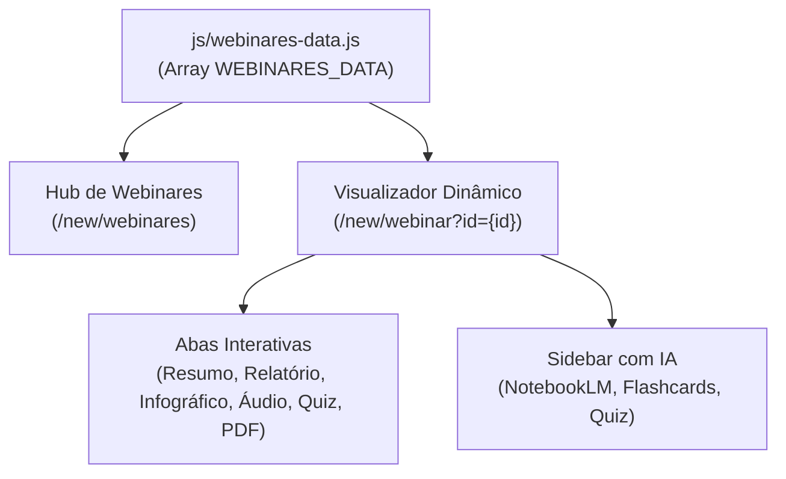

# Guia Oficial & Template para Criação de Novos Webinares - CathlabFlix by SBHCI

> Este documento serve como manual e guia de referência para Inteligências Artificiais e desenvolvedores cadastrarem novas páginas e conteúdos de webinares no CathlabFlix.

---

## 🏛️ 1. Como Funciona a Arquitetura de Webinares

A plataforma utiliza uma **arquitetura orientada a dados (Data-Driven Architecture)**:



> [!IMPORTANT]
> **Não é necessário duplicar arquivos HTML para cada novo webinar.**
> A página [`/new/webinar.html`](file:///Users/guilherme-wdcom/Desktop/Cathlabflix%20Sessions/new/webinar.html) funciona de forma dinâmica através do parâmetro `?id=slug-do-webinar`. Ao adicionar um novo item no arquivo [`js/webinares-data.js`](file:///Users/guilherme-wdcom/Desktop/Cathlabflix%20Sessions/js/webinares-data.js), ele se torna **imediatamente disponível** tanto na grade de busca do Hub quanto na página interna com todas as abas.

---

## 📋 2. Dicionário Completo de Campos

| Campo | Tipo | Obrigatório | Descrição | Exemplo |
| :--- | :---: | :---: | :--- | :--- |
| `id` | `string` | **Sim** | Identificador único em minúsculas (usado no `?id=...`). Sem acentos ou espaços. | `"magic-touch"` |
| `slug` | `string` | **Sim** | Rota amigável de compatibilidade ou URL original. | `"15-07-26-lacamento-magic-touch"` |
| `title` | `string` | **Sim** | Título completo e científico do webinar. | `"Lançamento Magic Touch - A nova era dos balões farmacológicos"` |
| `shortTitle` | `string` | **Sim** | Título curto (máx. 35 chars) para breadcrumbs e botões. | `"Lançamento Magic Touch"` |
| `date` | `string` | **Sim** | Data no padrão brasileiro (`DD/MM/AAAA`). | `"15/07/2026"` |
| `dateISO` | `string` | **Sim** | Data no padrão ISO (`AAAA-MM-DD`) para ordenação. | `"2026-07-15"` |
| `dateFormatted` | `string` | **Sim** | Data por extenso formatada em português. | `"15 de Julho de 2026"` |
| `category` | `string` | **Sim** | Nome de exibição da categoria médica. | `"Balões Farmacológicos"` |
| `categorySlug` | `string` | **Sim** | Slug para filtro no Hub: `"baloes"` \| `"estrutural"` \| `"coronaria"` \| `"jovem"` | `"baloes"` |
| `badge` | `string` | **Sim** | Etiqueta de destaque exibida no card do Hub. | `"Lançamento Oficial"`, `"Estudo Clínico"` |
| `duration` | `string` | **Sim** | Duração total estimada da aula gravada. | `"1h 15m"` |
| `thumbnail` | `string` | **Sim** | URL da imagem de capa (proporção 16:9 em alta definição). | `"https://static.wixstatic.com/...png"` |
| `vimeoId` | `string` | **Sim** | ID numérico do vídeo hospedado no Vimeo. | `"1210589447"` |
| `videoEmbedUrl` | `string` | **Sim** | URL de embed direto do Vimeo. | `"https://player.vimeo.com/video/1210589447"` |
| `infographicUrl` | `string` | **Sim** | Imagem do infográfico oficial para o visualizador com zoom. | `"https://static.wixstatic.com/...png"` |
| `infographicTitle`| `string` | Não | Título ou legenda explicativa do infográfico. | `"Ciência dos Balões Farmacológicos"` |
| `pdfUrl` | `string` | **Sim** | Link para download do blueprint ou artigo oficial em PDF. | `"https://www.cathlabflix.org/_files/ugd/...pdf"` |
| `pdfTitle` | `string` | Não | Título descritivo do documento em PDF. | `"Magic Touch Intervention Blueprint (PDF)"` |
| `notebookLm` | `object` | **Sim** | Objeto contendo os links do ecossistema NotebookLM: `notebookUrl`, `quizUrl`, `flashcardsUrl`. | Ver seção 4 abaixo |
| `audios` | `array` | **Sim** | Lista de faixas para o player de áudio e podcast com waveform. | Ver seção 5 abaixo |
| `summary` | `string` | **Sim** | Conteúdo em HTML formatado para a aba **Resumo**. | Ver seção 6 abaixo |
| `fullReport` | `string` | **Sim** | Conteúdo em HTML formatado para a aba **Relatório da Aula**. | Ver seção 7 abaixo |
| `quiz` | `array` | **Sim** | Questões clínicas para o **Quiz Interativo com IA**. | Ver seção 8 abaixo |

---

## 🤖 3. Objeto de Integração com o NotebookLM (`notebookLm`)

O painel lateral de IA conecta diretamente aos artefatos do Google NotebookLM da aula:

```javascript
notebookLm: {
  // Caderno principal de fontes e documentos
  notebookUrl: "https://notebooklm.google.com/notebook/797d1f51-4a06-4efb-9410-2edaf02fdf04",
  
  // Artefato direto do Quiz interativo
  quizUrl: "https://notebooklm.google.com/notebook/797d1f51-4a06-4efb-9410-2edaf02fdf04/artifact/eeefdf9e-8760-45a0-b8c1-bea6ecac2e63",
  
  // Artefato direto dos Flashcards
  flashcardsUrl: "https://notebooklm.google.com/notebook/797d1f51-4a06-4efb-9410-2edaf02fdf04/artifact/2513a738-c3e3-4b65-8c40-acedb9ebae21"
}
```

---

## 🎧 4. Lista de Áudios e Podcasts (`audios`)

Cada item adicionado na lista gera automaticamente um player com waveform e controles de velocidade (1x, 1.25x, 1.5x, 2x):

```javascript
audios: [
  {
    id: "slug-audio-1",
    title: "Nome_do_Audio_Sem_Caracteres_Especiais",
    artist: "IA CathlabFlix - NotebookLM",
    duration: "01:53",
    durationSec: 113,
    type: "Resumo em Áudio", // ou "Debate em Podcast" ou "Áudio do Webinar"
    desc: "Breve descrição do conteúdo abordado nesta faixa de áudio."
  }
]
```

---

## 📝 5. Classes CSS Prontas para a Aba 'Resumo' (`summary`)

O campo `summary` aceita HTML enriquecido. Utilize as seguintes classes pré-estilizadas do CathlabFlix:

```html
<!-- 1. Parágrafo introdutório ampliado -->
<p class="webinar-lead">
  Texto de abertura contextualizando o assunto e sua relevância clínica.
</p>

<!-- 2. Caixa lateral de destaque com borda vermelha -->
<div class="webinar-callout">
  <h4><span class="callout-icon">💡</span> Ponto Chave da Sessão</h4>
  <p>Mensagem essencial para a prática do hemodinamicista.</p>
</div>

<!-- 3. Grade de pilares numerados -->
<div class="webinar-highlights-grid">
  <div class="highlight-card">
    <div class="highlight-num">01</div>
    <div class="highlight-content">
      <strong>Primeiro Pilar</strong>
      <p>Detalhes técnicos ou critérios fundamentais.</p>
    </div>
  </div>
  <div class="highlight-card">
    <div class="highlight-num">02</div>
    <div class="highlight-content">
      <strong>Segundo Pilar</strong>
      <p>Mecanismos farmacológicos ou de imagem intravascular.</p>
    </div>
  </div>
</div>
```

---

## 📊 6. Classes CSS para a Aba 'Relatório da Aula' (`fullReport`)

Para tabelas comparativas acadêmicas:

```html
<h3>Título do Tópico</h3>
<p>Texto detalhado da aula...</p>

<!-- Tabela comparativa responsiva -->
<div class="table-responsive">
  <table class="webinar-comparison-table">
    <thead>
      <tr>
        <th>Critério</th>
        <th>Dispositivo / Técnica A</th>
        <th>Dispositivo / Técnica B</th>
      </tr>
    </thead>
    <tbody>
      <tr>
        <td><strong>Mecanismo</strong></td>
        <td><span class="badge-status success">Citostático</span></td>
        <td><span class="badge-status warning">Citotóxico</span></td>
      </tr>
    </tbody>
  </table>
</div>
```

---

## 🧠 7. Estrutura do Quiz Interativo (`quiz`)

O quiz é avaliado em tempo real no cliente com pontuação automática e justificativa clínica imediata:

```javascript
quiz: [
  {
    question: "Enunciado claro da questão clínica baseada na aula?",
    options: [
      "Alternativa A",
      "Alternativa B (Correta)",
      "Alternativa C",
      "Alternativa D"
    ],
    correctIndex: 1, // 0 = A, 1 = B, 2 = C, 3 = D
    explanation: "Justificativa clínica detalhada explicando o porquê da resposta correta."
  }
]
```

---

## 🚀 8. Passo a Passo para Adicionar um Novo Webinar

1. Abra o arquivo [`templates/webinar/webinar-template.js`](file:///Users/guilherme-wdcom/Desktop/Cathlabflix%20Sessions/templates/webinar/webinar-template.js).
2. Preencha os campos com os dados da nova aula da SBHCI.
3. Copie o objeto e cole no final do array `WEBINARES_DATA` dentro de [`js/webinares-data.js`](file:///Users/guilherme-wdcom/Desktop/Cathlabflix%20Sessions/js/webinares-data.js).
4. Verifique a sintaxe com:
   ```bash
   node --check js/webinares-data.js
   ```
5. Acesse no navegador:
   - Hub: `/new/webinares`
   - Página da aula: `/new/webinar?id={id-cadastrado}`

---

*Arquivos de suporte criados no repositório:*
- [`templates/webinar/webinar-template.js`](file:///Users/guilherme-wdcom/Desktop/Cathlabflix%20Sessions/templates/webinar/webinar-template.js): Template JavaScript pronto para copiar e colar.
- [`templates/webinar/webinar-template.json`](file:///Users/guilherme-wdcom/Desktop/Cathlabflix%20Sessions/templates/webinar/webinar-template.json): Schema JSON oficial para validação automática.
- [`templates/webinar/INSTRUCOES-WEBINAR-TEMPLATE.md`](file:///Users/guilherme-wdcom/Desktop/Cathlabflix%20Sessions/templates/webinar/INSTRUCOES-WEBINAR-TEMPLATE.md): Este guia completo de referência.
